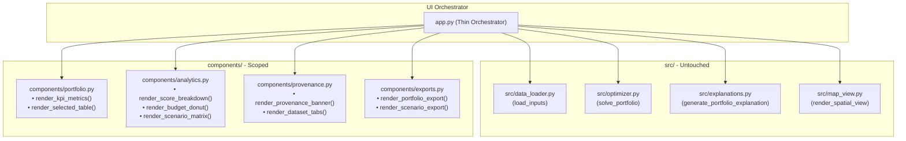

# Milestone 4 Architecture Review & Corrected Implementation Specification
## UI Component Decomposition & Feature Freeze Specification (Review Corrections Incorporated)

- **Milestone:** M4 — Architecture Modularization & Feature Freeze
- **Task ID:** M4-T1 / M4-T3
- **Date:** 2026-11-06
- **Author:** Antigravity (Primary Implementation Agent)
- **Technical Supervisor:** ChatGPT (Project Architect)
- **Final Authority:** Human Project Lead
- **Status:** **Specification Revised — Awaiting Human Project Lead Approval**
- **Active Branch:** `feature/m3-t5-ui-review`
- **Latest Commit:** `4bc1577` (Local commit on branch `feature/m3-t5-ui-review`)

---

## 1. Executive Summary & Precondition Audit

This corrected specification incorporates feedback from ChatGPT's review of the Milestone 4 proposal. It establishes a minimal, zero-risk presentation decomposition while strictly maintaining the frozen MVP, mathematical formulation, data schemas, and public interfaces.

### Precondition & Verification Check
1. **Branch & Commit Verification:**
   - Active branch: `feature/m3-t5-ui-review`.
   - Latest local commit: `4bc1577` (`docs(m4): prepare scoped ADR-009 and UI decomposition specification`).
   - Prior M3-T5 commit: `bff857f` (`fix(ui): resolve plotly import, enable zero budget bound, preserve export source note, and add regression tests (M3-T5)`).
   - Remote tracking status: Commit `4bc1577` is committed to the local Git repository. Due to Windows Git Credential Manager (GCM) invoking an interactive OAuth/browser authentication prompt in private repository communications, pushing requires executing `git push -u origin feature/m3-t5-ui-review` in an interactive shell.
   - PR URL: `https://github.com/sakshampise/climate-adaptation-optimizer/compare/dev...feature/m3-t5-ui-review?expand=1`
2. **Zero Code Modification Confirmation:**
   - **CONFIRMED:** Zero lines of application code (`app.py`, `src/*.py`, `tests/*.py`) have been modified or refactored during M4 specification.
   - All core module interfaces, optimization models, and scoring equations remain untouched.
3. **Current Test Status:**
   - All 27 unit, integration, and UI regression tests pass cleanly (`27 passed in 6.03s`).

---

## 2. Revised ADR-009 Governance Structure

ADR-009 in [`PROJECT DOCS/DECISIONS.md`](file:///c:/Users/saksh/OneDrive/Documents/Desktop/pccoe%20indradhanu/PROJECT%20DOCS/DECISIONS.md) decouples three independent architectural concerns:

```
                               ┌────────────────────────────────────────────────────────┐
                               │                    REVISED ADR-009                     │
                               └──────────────────────────┬─────────────────────────────┘
                                                          │
          ┌───────────────────────────────────────────────┼──────────────────────────────────────────────┐
          │                                               │                                              │
          ▼                                               ▼                                              ▼
┌───────────────────────────────┐           ┌───────────────────────────────┐          ┌───────────────────────────────┐
│     PART A: UI DECOMPOSITION  │           │   PART B: CORE MIGRATION      │          │   PART C: STANDALONE RISK     │
│  (PENDING HUMAN LEAD APPROVAL)│           │         (DEFERRED)            │          │         (DEFERRED)            │
├───────────────────────────────┤           ├───────────────────────────────┤          ├───────────────────────────────┤
│ • Extract presentation logic  │           │ • Retain src/data_loader.py   │          │ • No new composite risk model │
│   into 4 components/ modules  │           │ • Retain src/optimizer.py     │          │ • Retain additive scoring     │
│ • app.py as thin orchestrator │           │ • Retain src/explanations.py  │          │ • Exclude multiplicative risk │
│ • Preserve src/map_view.py    │           │ • Retain src/map_view.py      │          │ • Requires future formal spec │
└───────────────────────────────┘           └───────────────────────────────┘          └───────────────────────────────┘
```

- **Target Status upon Approval:** `APPROVED — SCOPED UI DECOMPOSITION ONLY` (recorded only after explicit sign-off by the Human Project Lead).
- **Parts B & C Formal Status:** `DEFERRED` (strictly out of scope for M4).

---

## 3. Component Architecture & Responsibility Map



### Module Responsibilities:

| Module | Exact Responsibilities | Public Function Signatures |
|---|---|---|
| **`components/portfolio.py`** | Executive KPI metric cards and selected adaptation package table formatting. | `render_kpi_metrics(result: dict, zones_count: int) -> None`<br>`render_selected_table(selected_df: pd.DataFrame, explanation_summary: str) -> pd.DataFrame` |
| **`components/analytics.py`** | Criteria breakdown horizontal bar, budget utilization donut, and 4-preset comparison grouped bar chart. | `render_breakdown_charts(score_breakdown: dict, total_cost: float, rem_budget: float) -> None`<br>`render_scenario_comparison(projects_df: pd.DataFrame, budget_crore: float) -> pd.DataFrame` |
| **`components/provenance.py`** | Header notice declaring simulated data status and baseline fixture explorer tabs. | `render_provenance_banner() -> None`<br>`render_dataset_tabs(zones_df: pd.DataFrame, projects_df: pd.DataFrame) -> None` |
| **`components/exports.py`** | CSV encoding and download buttons with mandatory provenance preservation (`data_status`, `source_note`). | `render_portfolio_export(table_df: pd.DataFrame, objective_id: str, budget_crore: float) -> None`<br>`render_scenario_export(scenario_df: pd.DataFrame, budget_crore: float) -> None` |
| **`app.py`** | Thin orchestrator: page configuration, sidebar inputs (budget slider, preset selectbox), solver invocation, spatial view, and top-level layout. | `main() -> None` |

---

## 4. Civic Metric Grounding & Labeling Guardrails

To prevent misleading claims during jury presentation and civic evaluation:

1. **Explicit Illustrative Benefit Labeling:**
   - All chart axes, titles, tooltips, metrics, and data tables MUST designate model outputs as **Illustrative / Relative Benefit Points** (e.g., `"Relative Benefit Score"`, `"Illustrative Multi-Criteria Resilience Points"`).
2. **Prohibition of Empirical Reduction Claims:**
   - Visualizations, component labels, and narrative explanations MUST NEVER describe or label model scores as empirical or validated hazard reductions (such as physical flood depth drops in meters, Celsius temperature decreases, or casualties prevented).
3. **Data Provenance Preservation:**
   - Prototype banners and dataset explorers must clearly label all simulated fixture attributes (`simulated` / `derived`) with literature-based source citations.

---

## 5. File-Level Implementation Plan (Review Corrections Incorporated)

### Correction 1: Removal of Arbitrary Line-Count Constraints
- **Removed hard requirement for `<120 LOC` or `~80 LOC` in `app.py`.**
- **Retained Thin-Orchestrator Objective:** `app.py` acts purely as an orchestrator managing application bootstrap, parameter collection, engine invocation, and component layout. Line count will naturally minimize based on separation of concerns, without artificial golfing or compressed syntax.

### Correction 2: Strict Boundary Isolation
- **Optimizer, scoring, data loading, and risk modeling are completely excluded from M4-T3.**
- `src/optimizer.py` (scoring formulas, knapsack constraints, tie-breaking) remains 100% frozen.
- `src/data_loader.py` (schema validation, CSV loading) remains 100% frozen.
- `data/reference/` (zones.csv, projects.csv) remains 100% frozen.
- No risk model calculation submodule (`src/risk_model/`) will be introduced.

### Correction 3: Preservation of Public Interfaces
- All public function signatures and module import paths remain unchanged:
  - `from src.data_loader import load_inputs, validate_zones_schema, validate_projects_schema`
  - `from src.optimizer import solve_portfolio, compute_project_score, OBJECTIVE_PRESETS`
  - `from src.explanations import generate_portfolio_explanation`
  - `from src.map_view import render_spatial_view`

### Component Extraction Breakdown:
- **`components/provenance.py`**:
  - `render_provenance_banner()`: Top-level disclaimer banner (`st.info`).
  - `render_dataset_tabs(zones_df, projects_df)`: Fixture tabs with formatted tables.
- **`components/portfolio.py`**:
  - `render_kpi_metrics(current_result, total_zones)`: 4 KPI metric cards.
  - `render_selected_table(selected_df, summary)`: Formats and displays portfolio table.
- **`components/exports.py`**:
  - `render_portfolio_export(table_df, objective_id, budget_crore)`: Selected portfolio CSV export.
  - `render_scenario_export(scenario_df, budget_crore)`: Multi-scenario comparison CSV export.
- **`components/analytics.py`**:
  - `render_breakdown_charts(score_breakdown, total_cost, rem_budget)`: Criteria breakdown and budget donut charts with strict "Relative Benefit" axis labels.
  - `render_scenario_comparison(projects_df, budget_crore)`: Computes and charts 4-preset comparison with "Illustrative Score" labels.

---

## 6. Acceptance Criteria & Behavioral Equivalence Testing

| Criterion | Requirement | Verification Method |
|---|---|---|
| **M4-AC01 — Behavioral Equivalence** | Automated equivalence check asserting identical portfolio selection, total score, total cost, remaining budget, excluded reasons, and CSV exports pre- and post-modularization. | New automated test suite `tests/test_ui_equivalence.py` executed across 4 presets and 6 budget points (₹0, ₹1.4, ₹15, ₹30, ₹50, ₹100 Cr). |
| **M4-AC02 — Optimizer Integrity** | Zero modifications to `src/optimizer.py`, weights, or tie-breaking logic. | `git diff src/optimizer.py` returns empty; `tests/test_optimizer.py` (9/9 pass). |
| **M4-AC03 — Metric Grounding** | All charts, tooltips, and explanations label outputs as illustrative/relative benefit points, never as empirical hazard drops. | Code inspection and chart configuration assertion tests. |
| **M4-AC04 — UI Correctness** | All 9 MVP sections remain available, responsive, and visually identical. | Headless Streamlit smoke test and layout inspection. |
| **M4-AC05 — Budget Boundaries** | Zero budget (0.0 Cr), low budget (1.4 Cr), and normal budgets work cleanly. | `test_zero_budget_pipeline_behavior()` in `tests/test_ui_regression.py`. |
| **M4-AC06 — Provenance** | Selected portfolio and scenario CSV exports preserve `data_status` and `source_note`. | `test_export_preserves_source_note_and_provenance()` passes. |
| **M4-AC07 — Scenario Comparison** | All 4 presets evaluated at identical budget with identical results. | `test_scenario_comparison_chart_construction()` passes. |
| **M4-AC08 — Map Fallback** | Retains tabular fallback in `src/map_view.py` on map rendering failure. | `src/map_view.py` exception handling test passing. |
| **M4-AC09 — Import Stability** | All existing public imports (`src.data_loader`, `src.optimizer`, etc.) work unchanged. | Zero test import modifications; full suite passes. |
| **M4-AC10 — Regression Tests** | Complete pytest suite passes without regressions. | `pytest` runs with 100% pass rate (27/27 passing). |
| **M4-AC11 — Startup Verification** | Application starts without import errors or exceptions. | Headless Streamlit launch on port 8502 exits cleanly. |

---

## 7. Atomic Implementation Sequence (Gated on Human Lead Approval)

1. **Gate 1:** Human Project Lead reviews this corrected specification and grants explicit approval.
2. **Step 1:** Create `tests/test_ui_equivalence.py` capturing pre-modularization baseline snapshots across presets and budget levels.
3. **Step 2:** Create `components/provenance.py` -> run `pytest`.
4. **Step 3:** Create `components/portfolio.py` -> run `pytest`.
5. **Step 4:** Create `components/exports.py` -> run `pytest`.
6. **Step 5:** Create `components/analytics.py` (incorporating strict "Relative Benefit" labels) -> run `pytest`.
7. **Step 6:** Refactor `app.py` into thin orchestrator -> run `pytest`.
8. **Step 7:** Run behavioral equivalence suite (`tests/test_ui_equivalence.py`) asserting 100% identity with baseline snapshots.
9. **Step 8:** Run headless Streamlit startup check on port 8502.
10. **Step 9:** Run complete test suite (all 27 baseline tests + equivalence tests passing).
11. **Step 10:** Commit to `feature/m3-t5-ui-review` (or dedicated feature branch) and file completion report.

---

## 8. Governance Reconciliation Summary

- **Two-Agent Model Operational:** ChatGPT serves as Project Architect and Technical Supervisor; Antigravity serves as Primary Implementation Agent; Human Project Lead serves as Executive Authority.
- **Gemini Status:** Gemini is retired from active operational assignments. All prior Gemini reports in `AI HANDOFFS/Gemini/` remain permanently preserved as historical audit records.
- **Milestone 3 Status Reconciled:** Milestone 3 is recorded as **In Final Review / 90% Complete** (M3-T1, M3-T2, M3-T3, and M3-T5 complete; M3-T4 reviewed with additive model retained, awaiting formal supervisor sign-off record before 100% closure).
- **Task Tracking Updated:** Both `PROJECT DOCS/TASKS.md` and `TASKS.md` have been updated with defensible task statuses and dependencies.

---

## 9. Current Authorization Boundary

**STATUS:** **HOLDING FOR HUMAN PROJECT LEAD APPROVAL**

*In strict accordance with project rules, no application code has been modified. ADR-009 remains in `PROPOSED — PENDING HUMAN PROJECT LEAD APPROVAL` status until explicit approval is recorded. M4-T3 implementation remains unauthorized until that approval is granted.*
