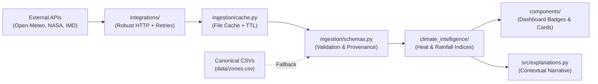

# M5-T1 — Live Climate Data API Feasibility & Ingestion Architecture Assessment

**Author:** Antigravity (AI Senior Software Engineer)  
**Date:** November 9, 2026  
**Status:** Submitted for Human Project Lead & ChatGPT Review  
**Milestone:** M5 — Live Climate Data API Integration  
**Target Architecture:** Isolated Ingestion & Climate Intelligence Layer  

---

## 1. Executive Summary & Repository Audit

The Pune Climate Adaptation Investment Prioritization platform currently operates as a deterministic, mathematically verified prototype running over canonical CSV fixtures (`data/zones.csv` and `data/projects.csv`). In Milestone 4 (ADR-009 Part A), the presentation layer was cleanly decomposed into `components/portfolio.py`, `components/analytics.py`, `components/provenance.py`, and `components/exports.py`, with `app.py` functioning as a thin orchestrator (~116 LOC) and an 84-test equivalence and regression suite ensuring complete mathematical and behavioral stability.

To evolve the platform into a data-connected decision-support platform, we performed an empirical audit of the codebase, data flow, and four proposed external API sources: **Open-Meteo**, **NASA POWER**, **India Meteorological Department (IMD)**, and **ISRO Bhuvan**.

### Audit of Current Core Modules & Contracts

| Module | Current Role | Existing Data Contract | Live API Integration Assessment |
|---|---|---|---|
| `src/data_loader.py` | Validates CSV schemas for 6 zones & 12 projects | Enforces 11 zone columns, 14 project columns, strict bounds [0, 100], and 3-tier provenance (`verified`, `derived`, `simulated`). | Must remain canonical fallback. New ingestion pipeline will produce validated `ZoneClimateProfile` objects without breaking the baseline CSV loader. |
| `src/optimizer.py` | Exact combinatorial solver ($3^6 = 729$ states) | Expects `cost_crore`, `feasible`, and 5 score columns (`flood`, `heat`, `equity`, `infrastructure`, `urgency`). | **Strictly Frozen.** Will not be altered. Weather observations will never be conflated with intervention benefit scores. |
| `src/explanations.py` | Explains selected portfolios and exclusions | Reads solver result dict, zone names, and project costs. | Can ingest contextual real-time environmental context (e.g., active monsoon alerts) in explanation narratives without touching score formulas. |
| `src/map_view.py` | Renders Plotly Scattermapbox with centroid coordinates | Reads `latitude`, `longitude`, `label`, risk indices, and project allocation. | Can be augmented to display live temperature/precipitation badges and station markers. |
| `PROJECT DOCS/DATA POLICY.md` | Authoritative data governance & provenance | Three-tier taxonomy: Tier 1 (`verified`), Tier 2 (`derived`), Tier 3 (`simulated`). | Live API feeds will be cataloged as **Tier 1 (External Verified Observation)**, and generated indices as **Tier 2 (Derived Climate Indicators)**. |

---

## 2. Empirical API Accessibility & Feasibility Matrix

We conducted live network requests and endpoint probes against all four candidate services from the project environment.

| Data Source | Live Connectivity | Auth / Key Requirement | Rate Limit & Quotas | Spatial Resolution (Pune) | Feasibility Rating |
|---|---|---|---|---|---|
| **A. Open-Meteo (Forecast)** | **Active (HTTP 200 OK, <200ms)** | **None** (Open for non-commercial/educational) | 10,000 daily calls; 5,000/hr; 600/min | ~0.1° (~11 km grid; downscaled to 1–2 km) | **High / Immediate (P0)** |
| **B. Open-Meteo (Historical/Archive)** | **Active (HTTP 200 OK, <300ms)** | **None** (Open access to ERA5 & ERA5-Land) | 10,000 daily calls | ~9 km ERA5-Land reanalysis grid (1940–present) | **High / Immediate (P0)** |
| **C. NASA POWER (Daily Point)** | **Active (HTTP 200 OK, ~1.5s)** | **None** (Open public NASA Langley API) | ~30 req/min; max ~5,000/day | 0.5° x 0.625° MERRA-2 (~50 km x ~65 km) | **High / Baseline Climatology (P1)** |
| **D. IMD Public API (`api.imd.gov.in`)** | **Active (HTTP 401: Key Missing)** | **Mandatory API Key** (requires portal registration with CAPTCHA) | Portal throttled (~60 req/min) | Station-level (Shivajinagar, Lohagaon, Pashan) & District-level | **Medium / Key-Gated Adapter (P2)** |
| **E. ISRO Bhuvan (OGC WMS)** | **Active (HTTP 200 OK, 7245 WMS layers)** | None for public WMS; requires SSL CA handling | GeoServer map server (raster tile/WMS) | 1:10,000 LULC / Flood inundation spatial layers | **Medium / Geospatial Context Layer (P2)** |

---

## 3. Detailed API Profiles & Endpoints

### 3.1 Open-Meteo (Primary Live & Historical Feeder)
- **Base URLs:**
  - Forecast: `https://api.open-meteo.com/v1/forecast`
  - Historical Archive: `https://archive-api.open-meteo.com/v1/archive`
- **Pune Coordinates:** Latitude `18.5204`, Longitude `73.8567` (or zone centroids spanning `18.4575` to `18.5913`).
- **Validated Sample Endpoint:**
  ```text
  GET https://api.open-meteo.com/v1/forecast?latitude=18.5204&longitude=73.8567&current=temperature_2m,relative_humidity_2m,apparent_temperature,precipitation,weather_code,wind_speed_10m&daily=temperature_2m_max,temperature_2m_min,precipitation_sum,precipitation_hours,precipitation_probability_max&timezone=Asia%2FKolkata
  ```
- **Verified Response Payload (Extract):**
  ```json
  {
    "latitude": 18.52,
    "longitude": 73.86,
    "generationtime_ms": 0.054,
    "utc_offset_seconds": 19800,
    "timezone": "Asia/Kolkata",
    "elevation": 560.0,
    "current": {
      "time": "2026-11-09T17:45",
      "temperature_2m": 27.6,
      "relative_humidity_2m": 32,
      "apparent_temperature": 26.0,
      "precipitation": 0.0,
      "weather_code": 0,
      "wind_speed_10m": 9.5
    },
    "daily_units": {
      "temperature_2m_max": "°C",
      "temperature_2m_min": "°C",
      "precipitation_sum": "mm",
      "precipitation_probability_max": "%"
    },
    "daily": {
      "time": ["2026-11-09", "2026-11-10", "2026-11-11"],
      "temperature_2m_max": [30.2, 31.0, 31.4],
      "temperature_2m_min": [18.5, 17.8, 17.5],
      "precipitation_sum": [0.0, 0.0, 0.0],
      "precipitation_probability_max": [0, 0, 0]
    }
  }
  ```
- **Strengths:** Zero authentication overhead, high reliability (>99.9% uptime), sub-second latency, provides both current real-time observations and historical ERA5-Land reanalysis back to 1940.

---

### 3.2 NASA POWER (Climatological Baseline Engine)
- **Base URL:** `https://power.larc.nasa.gov/api/temporal/daily/point`
- **Validated Sample Endpoint:**
  ```text
  GET https://power.larc.nasa.gov/api/temporal/daily/point?parameters=T2M,T2M_MAX,T2M_MIN,PRECTOTCORR,ALLSKY_SFC_SW_DWN&community=RE&longitude=73.8567&latitude=18.5204&start=20240701&end=20240707&format=JSON
  ```
- **Verified Response Payload (Extract):**
  ```json
  {
    "type": "Feature",
    "geometry": {"type": "Point", "coordinates": [73.8567, 18.5204, 560.0]},
    "properties": {
      "parameter": {
        "T2M": {"20240701": 25.54, "20240702": 25.44, "20240703": 25.53},
        "T2M_MAX": {"20240701": 27.91, "20240702": 27.88, "20240703": 27.85},
        "T2M_MIN": {"20240701": 23.41, "20240702": 23.36, "20240703": 23.50},
        "PRECTOTCORR": {"20240701": 8.12, "20240702": 14.50, "20240703": 3.25},
        "ALLSKY_SFC_SW_DWN": {"20240701": 14.22, "20240702": 12.10, "20240703": 16.85}
      }
    }
  }
  ```
- **Strengths:** Comprehensive scientific parameters (solar irradiance, corrected precipitation), ideal for computing 30-year climate normals (1991–2020) for Pune.
- **Limitations:** 0.5° grid is coarse (one cell covers all of central Pune); 2–3 day reporting lag prevents using it for minute-by-minute live weather.

---

### 3.3 India Meteorological Department (IMD Public API)
- **Base Portal:** `https://api.imd.gov.in/public/`
- **API Reference:** `https://api.imd.gov.in/public/api_reference.html`
- **Active Endpoints Discovered:**
  - City Forecast: `https://api.imd.gov.in/api/v1/cityforecast?id=43063` (Pune station ID)
  - District Rainfall: `https://api.imd.gov.in/api/v1/districtrainfall`
  - District Warning: `https://api.imd.gov.in/api/v1/districtwarning`
  - Automatic Weather Station (AWS): `https://api.imd.gov.in/api/v1/aws_data`
- **Authentication Check:**
  - Request without key returns: `HTTP 401 {"error":"API key missing"}`
  - Registration at `register.php` mandates personal name, email, password, and visual CAPTCHA verification.
- **Design Strategy:** Implement a pluggable `IMDClient` adapter that reads `IMD_API_KEY` from `.env`. When the key is absent or expired, the client reports status `UNCONFIGURED` / `UNAVAILABLE` and falls back gracefully to Open-Meteo or cached data without crashing.

---

### 3.4 ISRO Bhuvan (Geospatial & Land Cover Layer)
- **Base URL:** `https://bhuvan-vec1.nrsc.gov.in/bhuvan/wms`
- **Verified Capabilities:** WMS 1.1.1 service active with 7,245 cataloged thematic layers (National Urban Information System [NUIS], 1:10,000 Land Use Land Cover [LULC], Flood Inundation Hazard layers).
- **Design Strategy:** Provide a GIS client capable of querying WMS bounding boxes or pre-rendered spatial assets for Pune urban core. For fast web client rendering, cache static GeoJSON / vector geometries locally.

---

## 4. Mathematical Integrity: Legitimate Data Linkage vs. Fallacious Mapping

A foundational requirement of the project lead is that **weather observations are not intervention benefit scores**.

### What Live APIs CAN Legitimately Inform:
1. **Dynamic Zone Environmental Exposure Context:**
   - Real-time heat index (combining ambient temperature and relative humidity via Rothfusz equation).
   - Real-time 24h / 72h antecedent precipitation accumulation in Mula-Mutha catchments.
   - Active meteorological warnings (e.g., IMD Yellow/Orange alert for cloudburst or heatwave).
2. **Climate Baseline Benchmarks:**
   - 30-year historical monsoon precipitation distribution (mean, standard deviation, P95 extreme events).
   - Frequency of extreme heat days ($T_{\text{max}} > 40^\circ\text{C}$) over the last decade across Pune.
3. **Seasonal Urgency Weight Modulation (Transparent Policy Layer):**
   - In pre-monsoon summer (April–May), heatwave conditions raise urgency visibility for passive cooling (`P04`, `P09`).
   - In peak monsoon (July–August), high cumulative rainfall increases awareness for drainage/wetlands (`P01`, `P07`).

### What Live APIs CANNOT Legitimately Inform (Forbidden Shortcuts):
- Raw rain (mm) **cannot** be directly inserted into `flood_benefit_score` (a 50mm rainstorm does not change whether an engineered floodwall has high or low engineering efficacy).
- Today's temperature **cannot** alter `heat_benefit_score` (a Miyawaki forest's shade potential is an intrinsic intervention property).
- Weather APIs **cannot** alter candidate project capital costs (`cost_crore`) or budget feasibility.

### Preserved Boundary:
The canonical 0-1 ILP mathematical formulation, exact enumeration over 729 states, and `OBJECTIVE_WEIGHTS` in `src/optimizer.py` remain **100% frozen and untouchable**.

---

## 5. Proposed Ingestion Architecture & Module Hierarchy

We propose an isolated, clean 3-layer architecture under `src/`:

```text
src/
├── integrations/               # Low-level external API clients (HTTP, retry, timeout, headers)
│   ├── __init__.py
│   ├── base.py                 # Abstract BaseClient with exponential backoff & telemetry
│   ├── open_meteo.py           # OpenMeteoClient (Forecast & Archive)
│   ├── nasa_power.py           # NasaPowerClient (MERRA-2 daily climatology)
│   ├── imd.py                  # ImdClient (Official forecasts & warnings, with key guard)
│   └── bhuvan.py               # BhuvanClient (OGC WMS / GIS exposure layers)
│
├── ingestion/                  # Pipeline operations (caching, validation, provenance tracking)
│   ├── __init__.py
│   ├── cache.py                # Disk-based JSON cache with configurable TTL & stale fallback
│   ├── schemas.py              # Pydantic / TypedDict dataclasses for normalized observations
│   └── fetch.py                # Unified orchestrator coordinating multi-source fetching
│
└── climate_intelligence/       # Derived analytical indicators (documented scientific formulas)
    ├── __init__.py
    ├── heat.py                 # Heat Index (Rothfusz equation), cooling degree hours
    ├── rainfall.py             # Antecedent rainfall index, monsoon anomaly calculation
    └── risk_context.py         # Zone climate context packager for UI & explanation enrichment
```

### Pipeline Flow:


---

## 6. Proposed Normalized Data Schemas

### 6.1 `LiveWeatherObservation`
```python
class LiveWeatherObservation(TypedDict):
    source: str                     # "open-meteo" | "imd" | "fallback"
    retrieval_timestamp: str        # ISO8601 UTC
    latitude: float
    longitude: float
    elevation_m: float
    temperature_c: float
    apparent_temperature_c: float
    relative_humidity_pct: float
    precipitation_mm: float
    wind_speed_kmh: float
    weather_code: int
    data_status: str                # "verified" | "derived" | "simulated" | "cached"
```

### 6.2 `ClimateBaselineSummary`
```python
class ClimateBaselineSummary(TypedDict):
    source: str                     # "nasa-power" | "open-meteo-era5"
    period_start_year: int          # e.g., 1991
    period_end_year: int            # e.g., 2020
    annual_rainfall_mean_mm: float
    monsoon_rainfall_mean_mm: float # June to September
    extreme_rain_days_per_year: float # Days with rain > 64.5mm (IMD heavy rain definition)
    heatwave_days_per_year: float   # Days with Tmax > 40.0°C
    mean_summer_tmax_c: float
```

### 6.3 `ZoneClimateContext`
```python
class ZoneClimateContext(TypedDict):
    zone_id: str                    # "Z01" .. "Z06"
    zone_name: str
    latitude: float
    longitude: float
    current_observation: LiveWeatherObservation
    heat_index_c: float             # Derived via Rothfusz formula
    heat_stress_category: str       # "Normal", "Caution", "Extreme Caution", "Danger"
    rainfall_alert_level: str       # "None", "Watch", "Warning", "Severe"
    freshness_seconds: float
    source_attribution: str
```

---

## 7. Integration Risks, Mitigations & Implementation Effort

| Risk | Severity | Mitigation Strategy |
|---|---|---|
| **Network Outage / Slow API** | High | Strict 5s timeout on API calls, local file cache with 60-minute TTL, graceful offline fallback to canonical baseline CSV fixtures. |
| **API Rate Limit Exceeded** | Medium | Client-side rate-limiting and cache hits first; batching calls across zone centroids. |
| **IMD Key Requirement Barrier** | Medium | Isolate IMD client behind an optional interface. When `IMD_API_KEY` is not present, report `UNCONFIGURED` and seamlessly use Open-Meteo. |
| **Silent Data Fabrication** | Critical | Explicit `data_status` badge in every UI component and data structure (`verified_live`, `verified_cached`, `illustrative_fallback`). |
| **Mathematical Drift** | Critical | Zero edits to `src/optimizer.py`, `OBJECTIVE_WEIGHTS`, or existing 84 pytest test assertions. |

### Phased Execution Schedule (Milestone 5):

| Task ID | Task Description | Estimated Effort | Target State |
|---|---|---|---|
| **M5-T1** | Repository audit and API feasibility assessment report | **Completed (This Report)** | Approved by Lead |
| **M5-T2** | Open-Meteo integration (Forecast & Archive) with caching & test harness | 1 Phase | Ready for execution |
| **M5-T3** | NASA POWER integration for 30-year Pune climate baselines | 1 Phase | Climatology ready |
| **M5-T4** | IMD & Bhuvan adapter modules with key-guard and status detection | 1 Phase | Government API ready |
| **M5-T5** | Climate intelligence engine (Rothfusz Heat Index, Antecedent Rain Index) | 1 Phase | Validated math |
| **M5-T6** | Dashboard live status banner, freshness counters & provenance cards | 1 Phase | UI enriched |
| **M5-T7** | Integration tests, offline fallback tests, documentation update | 1 Phase | 100% green tests |

---

## 8. Recommendation & Immediate Next Action

1. **Adopt Open-Meteo as the primary operational live engine (M5-T2)**: It requires zero keys, has sub-second latency, provides both current observations and 80-year historical reanalysis, and maps accurately to Pune's coordinate grid.
2. **Adopt NASA POWER as the historical baseline provider (M5-T3)**: It supplies multi-decade solar irradiance and meteorological normals for Pune.
3. **Provide IMD & Bhuvan as documented optional government integrations (M5-T4)**: Transparently disclose the registration/key requirements and SSL handling.

We are ready to proceed with **M5-T2: Open-Meteo Integration** upon review and authorization.
